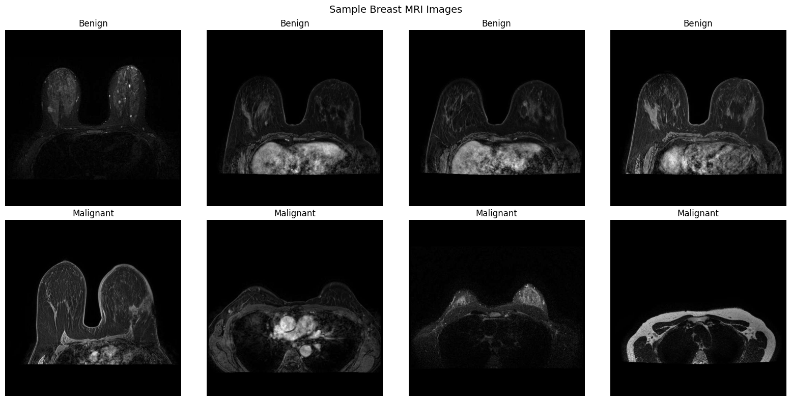
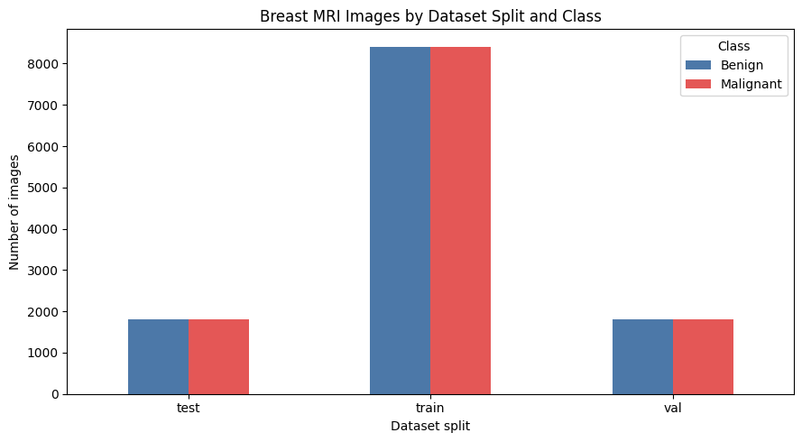
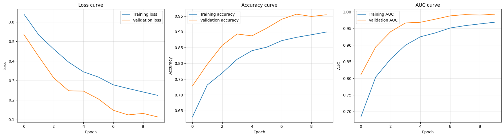
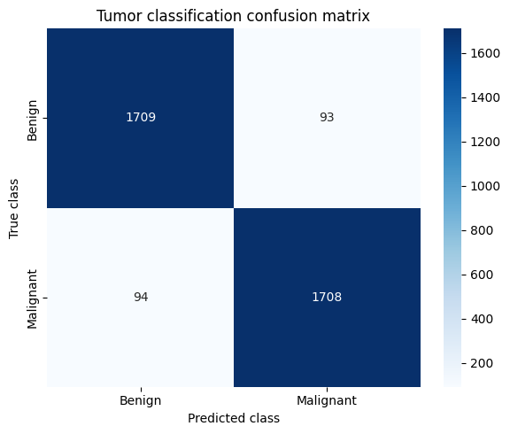
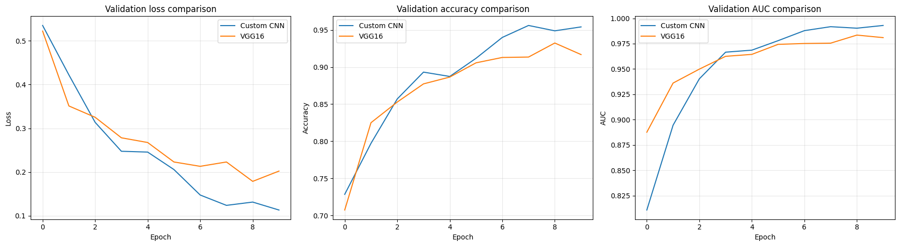
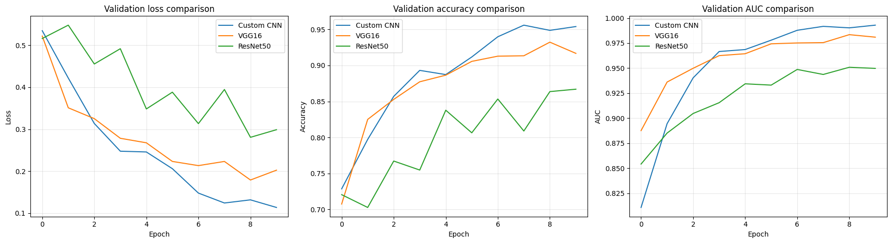
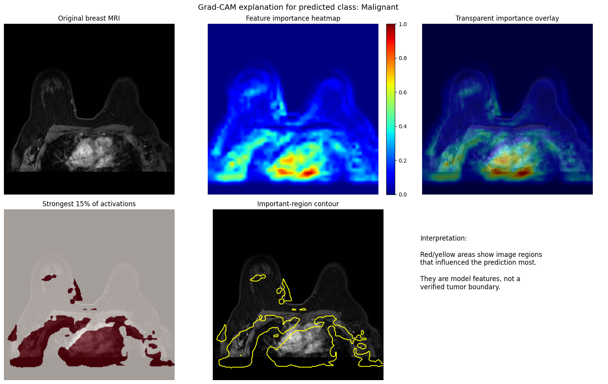

# Breast MRI Tumor Classification
### Comparison of CNN, Resnet50 and VGG16 For Breast MRI Tumor Classification

<p align="center">
  
  
  
  
  
</p>

---

## Project Overview

This project compares three deep learning architectures for **binary classification of Breast MRI images** into:
- **Benign** — non-cancerous tumor
- **Malignant** — cancerous tumor

The models benchmarked are:
1. **Custom CNN** — built from scratch with 3 convolutional blocks
2. **VGG16** — pretrained on ImageNet (transfer learning, frozen base)
3. **ResNet50** — pretrained on ImageNet (transfer learning, frozen base)

A **Grad-CAM** explainability layer is included to visualize which MRI regions influenced each prediction.

---

## Dataset

| Property | Details |
|----------|---------|
| **Source** | [Kaggle — Breast MRI Tumor Classification Dataset](https://www.kaggle.com/datasets/abenjelloun/breast-mri-tumor-classification-dataset) |
| **Format** | JPEG images · RGB · resized to 224x224 |
| **Classes** | Benign · Malignant (balanced) |

### Dataset Split

| Split | Benign | Malignant | Total |
|-------|:------:|:---------:|:-----:|
| **Train** | 8,413 | 8,413 | **16,826** |
| **Val** | 1,797 | 1,797 | **3,594** |
| **Test** | 1,802 | 1,802 | **3,604** |

The dataset is **perfectly balanced** — equal Benign and Malignant samples in every split.

---

## Sample MRI Images

<p align="center">
  
</p>
<p align="center"><i>Top row: Benign &nbsp;|&nbsp; Bottom row: Malignant</i></p>

---

## Class Distribution

<p align="center">
  
</p>
<p align="center"><i>Perfectly balanced classes across train, validation, and test splits</i></p>

---

## Model Architectures

### 1. Custom CNN (Built from Scratch)

```
Input (224x224x3)
  -> Rescaling (÷255) + Data Augmentation
  -> Conv2D(32, 3x3, ReLU) -> MaxPool2D
  -> Conv2D(64, 3x3, ReLU) -> MaxPool2D
  -> Conv2D(128, 3x3, ReLU) -> MaxPool2D
  -> Flatten
  -> Dense(512, ReLU) -> Dropout(0.5)
  -> Dense(1, Sigmoid)
```

### 2. VGG16 (Transfer Learning)

```
Input (224x224x3)
  -> Data Augmentation -> VGG16 Preprocess
  -> VGG16 Base (frozen, ImageNet weights)
  -> GlobalAveragePooling2D
  -> Dense(128, ReLU) -> Dropout(0.5)
  -> Dense(1, Sigmoid)
```

### 3. ResNet50 (Transfer Learning)

```
Input (224x224x3)
  -> Data Augmentation -> ResNet50 Preprocess
  -> ResNet50 Base (frozen, ImageNet weights)
  -> GlobalAveragePooling2D
  -> Dense(128, ReLU) -> Dropout(0.5)
  -> Dense(1, Sigmoid)
```

---

## Training Configuration

| Setting | Value |
|---------|-------|
| **Image Size** | 224 x 224 |
| **Batch Size** | 32 |
| **Optimizer** | Adam (lr = 0.001) |
| **Loss** | Binary Cross-Entropy |
| **Metrics** | Accuracy, AUC |
| **Max Epochs** | 10 |
| **Early Stopping** | patience = 5 (Custom CNN) / 3 (VGG16, ResNet50) |
| **LR Scheduler** | ReduceLROnPlateau (factor = 0.5) |

### Data Augmentation
- Random Rotation (±10 degrees)
- Random Zoom (10%)
- Random Translation (5%)
- Horizontal Flip

---

## Training Results

### Custom CNN — Loss, Accuracy and AUC Curves

<p align="center">
  
</p>
<p align="center"><i>Training vs Validation — Loss · Accuracy · AUC over 10 epochs</i></p>

---

### Custom CNN — Confusion Matrix (Test Set)

<p align="center">
  
</p>
<p align="center"><i>Test set predictions on 3,604 images (1,802 Benign + 1,802 Malignant)</i></p>

#### Classification Report — Custom CNN

```
              precision    recall  f1-score   support

      Benign       0.95      0.95      0.95      1802
   Malignant       0.95      0.95      0.95      1802

    accuracy                           0.95      3604
   macro avg       0.95      0.95      0.95      3604
weighted avg       0.95      0.95      0.95      3604

Test accuracy: 0.9481
```

---

### CNN vs VGG16 — Validation Comparison

<p align="center">
  
</p>
<p align="center"><i>Validation Loss · Accuracy · AUC — Custom CNN vs VGG16</i></p>

---

### All Models — Final Comparison

<p align="center">
  
</p>
<p align="center"><i>Validation Loss · Accuracy · AUC — Custom CNN vs VGG16 vs ResNet50</i></p>

---

## Results Summary

| Model | Test Accuracy | Test AUC | Precision | Recall | F1-Score |
|-------|:------------:|:--------:|:---------:|:------:|:--------:|
| **Custom CNN** | **94.81%** | — | **0.95** | **0.95** | **0.95** |
| **VGG16** | 92.12% | **0.9816** | — | — | — |
| **ResNet50** | 86.90% | 0.9521 | — | — | — |

**Custom CNN wins on accuracy** (94.81%) despite having no pretrained weights.  
**VGG16 achieves the highest AUC** (0.9816) — the most reliable metric in clinical cancer screening since it measures discrimination regardless of threshold.

---

## Grad-CAM Explainability

Grad-CAM highlights the **exact MRI regions** that most influenced the model's prediction — critical for clinical trust and medical AI transparency.

<p align="center">
  
</p>
<p align="center">
  <i>
    Top-left: Original MRI &nbsp;|&nbsp;
    Top-center: Importance Heatmap &nbsp;|&nbsp;
    Top-right: Overlay &nbsp;|&nbsp;
    Bottom-left: Top 15% Activations &nbsp;|&nbsp;
    Bottom-center: Contour Boundary
  </i>
</p>

The Grad-CAM implementation:
- Generates a gradient-weighted heatmap from the last Conv2D layer
- Highlights the top 15% strongest activations
- Draws a contour boundary around the most important region
- Applies a color-mapped overlay for intuitive visualization

---

## Project Structure

```
Breast_mri/
|
|-- Breast_mri.ipynb         # Main notebook (EDA + training + evaluation + Grad-CAM)
|-- assets/                  # Visualizations extracted from notebook outputs
|   |-- sample_mri_images.png
|   |-- class_distribution.png
|   |-- cnn_training_curves.png
|   |-- cnn_confusion_matrix.png
|   |-- gradcam_visualization.png
|   |-- cnn_vgg_comparison.png
|   `-- all_models_comparison.png
|-- .gitignore
|-- LICENSE
`-- README.md
```

---

## How to Run

### Option 1: Kaggle (Recommended — Free GPU)
1. Go to [Kaggle Notebooks](https://www.kaggle.com/code)
2. Import `Breast_mri.ipynb`
3. Enable **GPU accelerator** (P100 or T4)
4. Run All Cells — dataset downloads automatically via `kagglehub`

### Option 2: Local

```bash
# Clone the repository
git clone https://github.com/iamahnaf/Breast.git
cd Breast

# Install dependencies
pip install tensorflow scikit-learn numpy pandas matplotlib seaborn pillow kagglehub

# Place your kaggle.json in:
#   ~/.kaggle/kaggle.json        (Linux/macOS)
#   C:\Users\<user>\.kaggle\     (Windows)

# Launch Jupyter
jupyter notebook Breast_mri.ipynb
```

---

## Requirements

```
tensorflow>=2.13
scikit-learn
numpy
pandas
matplotlib
seaborn
pillow
kagglehub
```

---

## Key Findings

- The **Custom CNN outperformed both pretrained models on accuracy** — MRI images differ significantly from natural ImageNet images, so frozen transfer learning has less domain advantage without fine-tuning.
- **VGG16 achieved the best AUC (0.9816)** — most reliable for minimizing missed malignancies (false negatives), which is the priority in cancer screening.
- **ResNet50 performed worst at 86.90%** — its deeper residual architecture needs fine-tuning to adapt well to this medical domain.
- **Grad-CAM confirms** the model focuses on anatomically meaningful tumor regions rather than background artifacts.

---

## Future Work

- Fine-tune VGG16 and ResNet50 (unfreeze last layers, lr = 1e-5)
- Add ROC curve comparison plot
- Try EfficientNetB0 and DenseNet121
- Apply cross-validation for more robust evaluation
- Deploy as a web app using Gradio or Streamlit

---

## Author

**Ahnaf** — [@iamahnaf](https://github.com/iamahnaf)

---

## License

This project is open source and available under the [MIT License](LICENSE).
